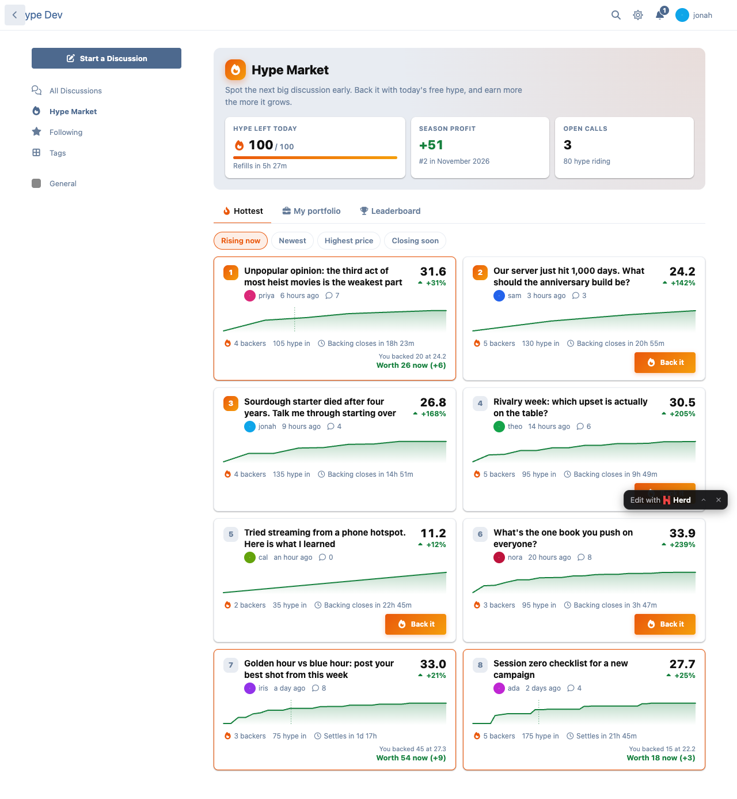
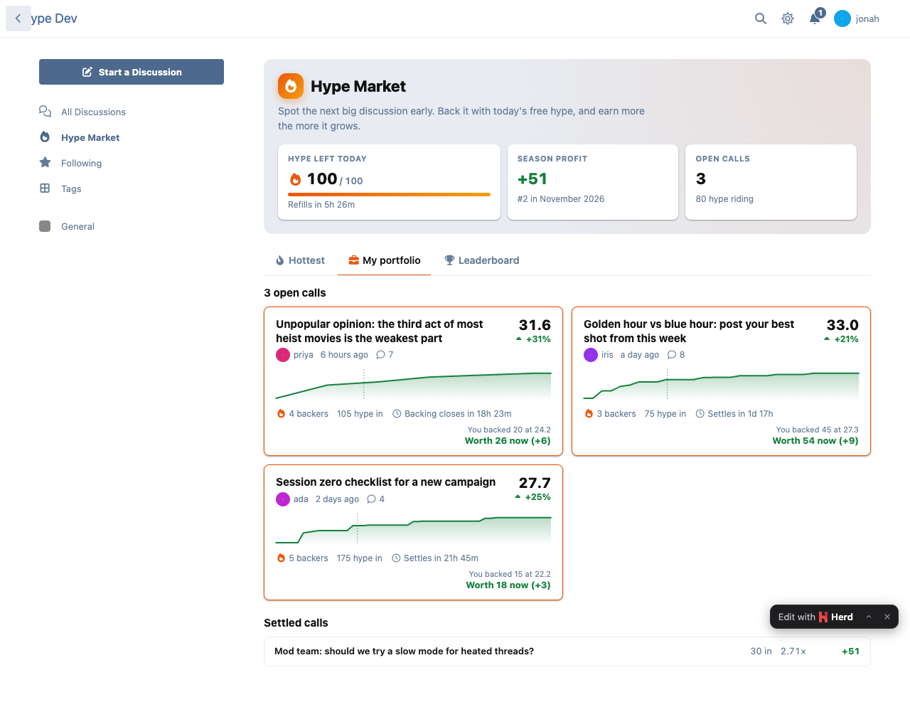
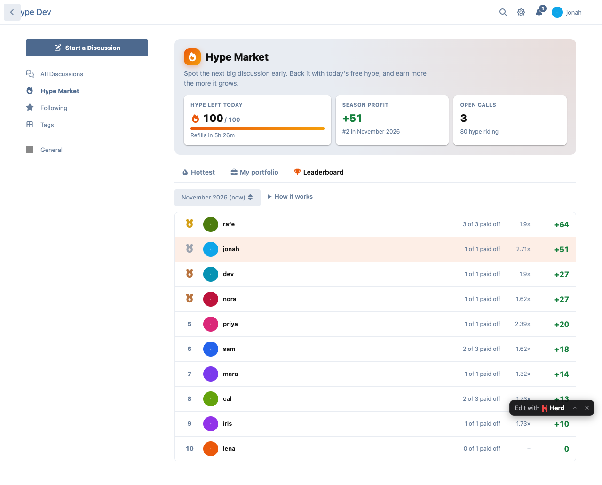
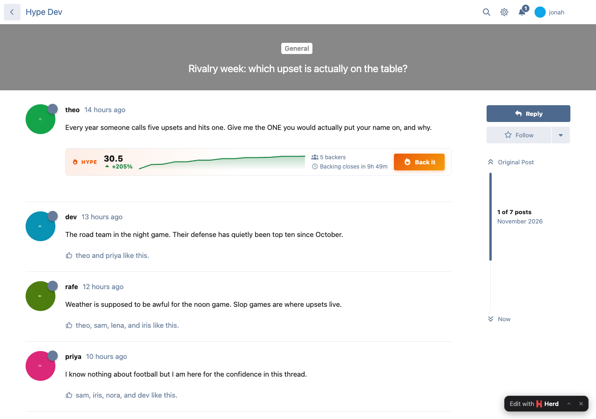
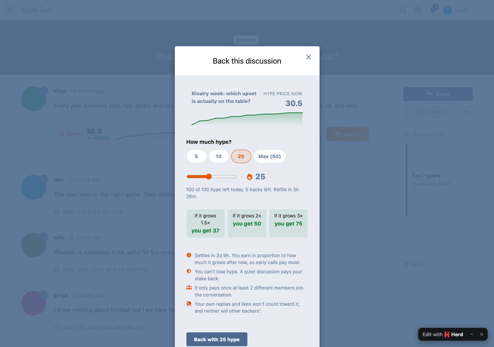
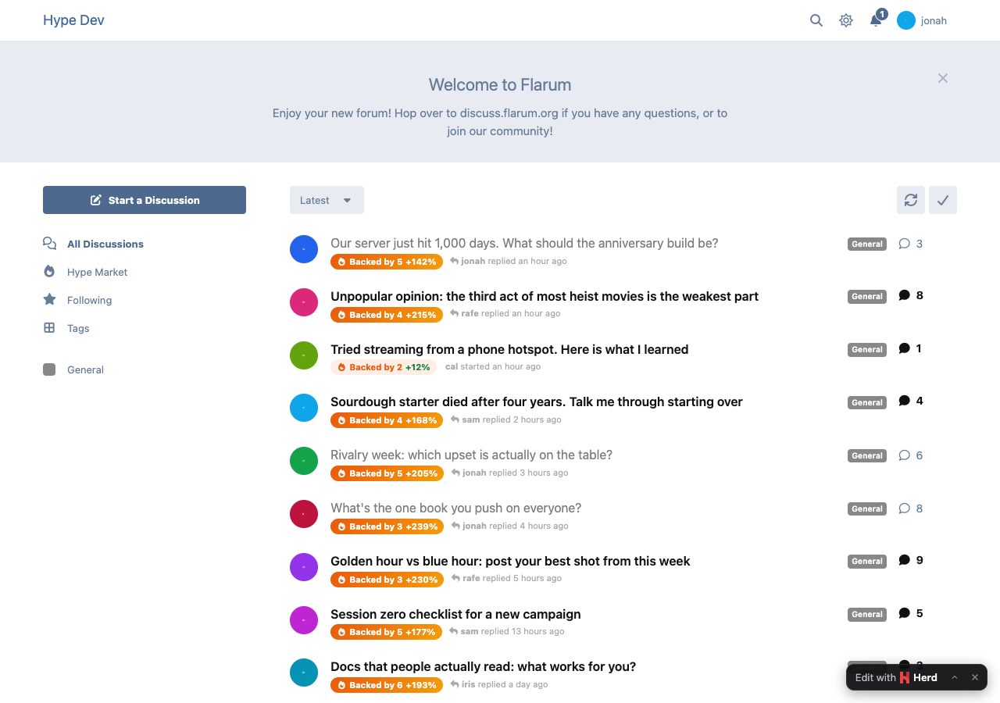
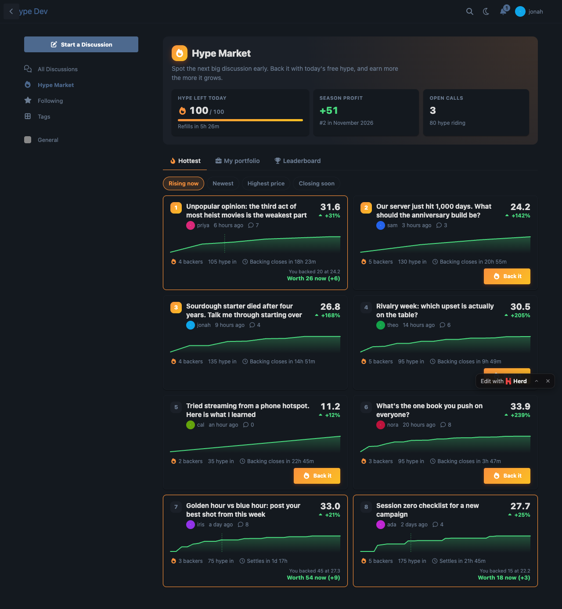

# Hype Market

[](LICENSE) [](https://packagist.org/packages/ernestdefoe/hype-market)

A [Flarum 2](https://flarum.org) extension. Members back the new discussions they think will take off.

Every member gets free **hype** every day. No real money, nothing to buy. They spend it backing young discussions, and each discussion's **hype price** climbs as real conversation happens in it. When the market settles a few days later, backers earn in proportion to how much the discussion grew after they backed it, so the early, good calls pay most. A monthly leaderboard keeps score.



## What members get

- **Hottest right now**: every open market with its price, change, sparkline, backers and the time left, sorted by what's rising (or newest, highest price, closing soon).
- **Back it**: a stake out of today's hype, with what it pays at 1.5×, 2× and 3× growth. You can't lose hype: a quiet discussion pays your stake back.
- **My portfolio**: open calls with a sparkline each (your entry marked) and what they're worth now, plus every settled call.
- **Leaderboard**: season profit, calls that paid off, best single call. Past seasons stay browsable.
- **A "Backed by 12" chip** on discussion cards and a **market bar** under a young discussion's first post.
- **Alerts** when a call pays off or settles flat.

## How the price works

A discussion's price starts at 10 and follows its engagement during the market window (72 hours by default):

- each member's first replies count (1, then ½, then ¼; nothing after three), plus 3 for every member who joined in,
- likes count ½ each, at most three per member,
- `price = 10 × (1 + ln(1 + engagement / 4))`, so a pile-on is worth less than a conversation.

A position pays `stake × (price at settlement ÷ price when you backed)`, between 1× and 10×. By default nobody loses hype: a quiet discussion pays the stake back.

**Losing hype is an option.** Set *Hype a quiet call loses (%)* above 0 and a call that stays flat loses that share of its stake; it has to grow past it to profit (at 50%, a call breaks even at 1.5×). Each call keeps the rate it was made with, so changing the setting never changes calls already open. A called-off market always refunds every stake.

## Anti-farming

Built so the only way to win is to spot good discussions early.

- You can't back your own discussion, and its author's replies never count.
- **Backers' own replies and likes never count**, for anyone: back it and then reply, or get a fellow backer to, and nothing moves. A later backer's earlier replies are taken out of everyone's numbers too.
- Replies and likes from **low-trust accounts** don't count: unconfirmed email, fewer than 3 posts outside the discussion itself, or an account younger than 7 days *when it acted*.
- Posts dated before the discussion started (merged in from elsewhere) don't count.
- One-word replies, quote-only replies, hidden, private and unapproved posts don't count. Liking your own post doesn't count.
- A market only pays once **at least 2 different members** (not the author or backers) took part.
- **The same members can lift one backer's calls only 5 times a season**: a ring of friends taking turns stops paying.
- **Daily caps**: 100 hype a day, 5–50 per discussion, 5 backs a day, one position per discussion (also a unique key).
- **Race-safe**: backing locks the market and the member's day row and re-checks everything inside the transaction; prices are always computed by the server.
- **Settlement is server-side, idempotent and race-safe**: the scheduler settles each market under a row lock exactly once; a late run lands on the same numbers (nothing after the settle time counts); season totals are recounted, never added to.
- Moderators can **call off** a market that was gamed: every stake comes back flat. A discussion hidden, deleted or made private before it settles is called off automatically.

Each of these has an integration test.

With flarum/gdpr, a member's data export includes their calls and season totals, and erasing them removes those.

## Settings

Admin → Hype Market: daily hype, how much a quiet call loses (0 by default), smallest and largest stake, backs per day, how long a discussion can be backed, when it settles, account age and post count before activity counts, members needed for a payout, monthly or manual seasons (with "End this season now"), and whether the scheduler is running. Permissions: view, back, call off markets.

> **The scheduler must run** (`php flarum schedule:run` every minute from cron): it prices, settles and starts new seasons every five minutes.

## Installation

```sh
composer require ernestdefoe/hype-market
```

## Updating

```sh
composer update ernestdefoe/hype-market
php flarum migrate
php flarum cache:clear
```

## Links

- [Packagist](https://packagist.org/packages/ernestdefoe/hype-market)
- [GitHub](https://github.com/ernestdefoe/hype-market)
- ☕ [Buy me a coffee](https://buymeacoffee.com/ernestdefoe)

## More screenshots

| | |
|---|---|
|  |  |
|  |  |
|  |  |
